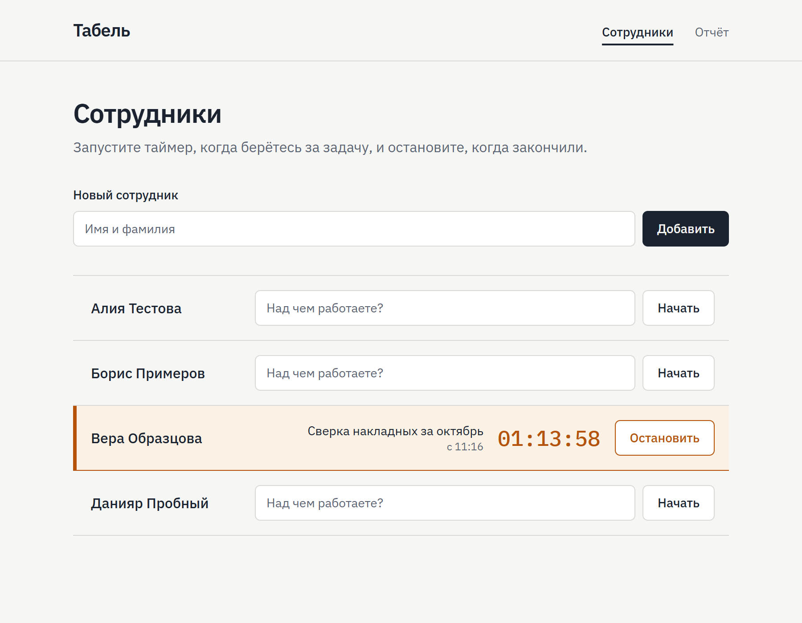
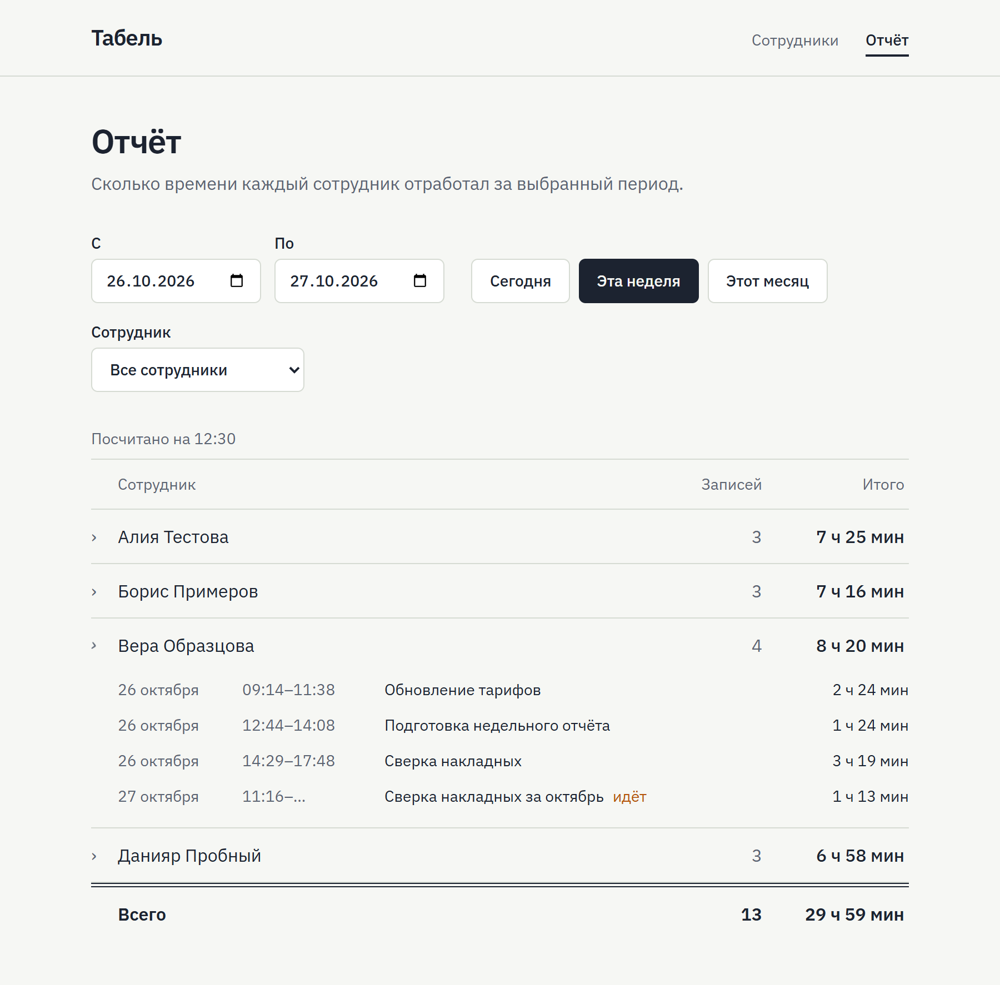

# Табель — учёт рабочего времени

Веб-приложение для учёта рабочего времени сотрудников, сделанное как тестовое задание. В нём можно добавлять сотрудников, запускать и останавливать таймер с описанием задачи и смотреть записи и общее время каждого сотрудника за выбранный период. Данные хранятся в SQLite и не теряются при перезапуске.

Все имена, задачи и записи в приложении, тестах и на скриншотах вымышленные.

<p>
  
  
</p>

Подробности: план работы — [docs/plan.md](docs/plan.md), журнал работы с ИИ — [docs/ai-log.md](docs/ai-log.md).

## Содержание

- [Быстрый старт](#быстрый-старт)
- [Требования задания и тесты](#требования-задания-и-тесты)
- [Как устроено](#как-устроено)
- [Тесты](#тесты)
- [Как использовался ИИ](#как-использовался-ии)
- [Безопасность](#безопасность)
- [Ограничения и что улучшить](#ограничения-и-что-улучшить)

## Быстрый старт

Нужен Node.js 22 или новее.

```bash
npm install
npm run db:seed
npm run dev
```

Приложение откроется на http://localhost:3000.

- `npm run db:seed` необязателен. Он добавляет в пустую базу четырёх вымышленных сотрудников и их записи за рабочие дни последней недели, чтобы отчёт не был пустым.
- Данные лежат в файле `data/worktime.db`. `npm run dev` и `npm start` при каждом запуске применяют миграции, так что база создаётся сама, а после перезапуска всё на месте.

Production-сборка:

```bash
npm run build
npm start
```

### Настройки

Без настроек приложение работает с локальным файлом. Чтобы подключить другую базу, скопируйте `.env.example` в `.env.local`.

| Переменная            | По умолчанию                             | Для чего                                       |
| --------------------- | ---------------------------------------- | ---------------------------------------------- |
| `DATABASE_URL`        | пусто, то есть `file:./data/worktime.db` | файл SQLite или `libsql://…` для базы на Turso |
| `DATABASE_AUTH_TOKEN` | пусто                                    | токен доступа к Turso                          |

Именно `.env.local`, а не `.env.development`: его читают и `next dev`, и `next start`, и скрипты `db:migrate` и `db:seed`.

### Команды

| Команда                      | Что делает                                                                                    |
| ---------------------------- | --------------------------------------------------------------------------------------------- |
| `npm run dev`                | миграции и dev-сервер                                                                         |
| `npm run build`, `npm start` | production-сборка; `npm start` применяет миграции и запускает её                              |
| `npm run db:seed`            | вымышленные данные в пустую базу; `npm run db:seed -- --reset` сначала удаляет **все** данные |
| `npm test`                   | unit- и интеграционные тесты (Vitest)                                                         |
| `npm run test:e2e`           | браузерные тесты (Playwright); нужен установленный Google Chrome                              |
| `npm run check`              | ESLint, проверка типов и тесты одной командой                                                 |
| `npm run format`             | форматирование (Prettier)                                                                     |

## Требования задания и тесты

| Требование                              | Как сделано                                                                                                                  | Где проверяется                                                                                   |
| --------------------------------------- | ---------------------------------------------------------------------------------------------------------------------------- | ------------------------------------------------------------------------------------------------- |
| Добавление сотрудников                  | имя без пробелов по краям, от 1 до 100 символов, хотя бы одна буква или цифра                                                | `tests/integration/employees.test.ts`, `tests/api/handlers.test.ts`, e2e                          |
| Старт и стоп таймера с описанием задачи | старт создаёт запись без времени окончания, стоп закрывает именно эту запись                                                 | `tests/integration/timer.test.ts`, `tests/api/handlers.test.ts`, e2e                              |
| Записи и общее время за период          | период от местной полуночи до местной полуночи; записи обрезаются по его границам, идущий таймер считается до момента ответа | `tests/unit/report.test.ts`, `tests/integration/report.test.ts`, `tests/unit/period.test.ts`, e2e |
| Сохранение после перезапуска            | файл SQLite; идущий таймер — строка в базе, а не состояние процесса                                                          | `tests/integration/persistence.test.ts`, ручная проверка с остановкой сервера                     |
| Тест повторного запуска таймера         | все прочтения, см. ниже                                                                                                      | `tests/integration/timer-restart.test.ts`, `tests/integration/persistence.test.ts`                |
| Тест пустого отчёта                     | нули, а не `null`: и когда записей нет, и когда нет сотрудников                                                              | `tests/unit/report.test.ts`, `tests/integration/report.test.ts`, `tests/api/handlers.test.ts`     |
| Простой интерфейс без авторизации       | две страницы: «Сотрудники» и «Отчёт»                                                                                         | e2e на компьютере и на телефоне                                                                   |
| Только вымышленные данные               | выдуманные имена в демо-данных и тестах: фамилии значат «тест», «пример», «образец» и «проба»                                | `src/server/db/seed.ts`                                                                           |

**«Повторный запуск таймера».** В английской версии задания сказано «restarting the timer», в русской — «повторный запуск таймера». Чтобы не гадать, тестами покрыты все прочтения:

- второй старт, пока таймер идёт: ответ 409, идущая запись не меняется;
- старт, стоп и снова старт: появляется новая запись, первая остаётся закрытой;
- два одновременных старта, как при двойном клике: выигрывает ровно один;
- вставка второй идущей записи в обход сервиса: правило держит сама база;
- перезапуск приложения при идущем таймере: таймер идёт дальше с тем же временем старта.

## Как устроено

### Стек

Next.js 16 (App Router) и React 19, TypeScript, SQLite через libSQL и Drizzle ORM, zod 4, Tailwind CSS 4. Тесты — Vitest 5 и Playwright.

Интерфейс и API живут в одном приложении. SQLite не требует отдельного сервера, а тот же драйвер libSQL подключается к Turso, поэтому для демо подходит тот же код.

### Структура

```
src/
├─ app/            страницы и API-маршруты Next.js
├─ components/     интерфейс: страница сотрудников, отчёт, два своих примитива
├─ lib/            код интерфейса без React: клиент API, периоды, форматирование
└─ server/
   ├─ db/          схема, подключение, вымышленные данные
   ├─ tracking/    правила учёта: сервис, отчёт, проверка ввода, ошибки
   └─ http/        HTTP-слой: обработчики, статусы ошибок, защита запросов
drizzle/           SQL-миграции
scripts/           миграции и демо-данные из командной строки
tests/             unit, integration, api, smoke и e2e
docs/              план, журнал работы с ИИ, скриншоты
```

### Модель данных

```
employees                        time_entries
──────────────────────────       ──────────────────────────────────────────
id          integer, ключ        id           integer, ключ
name        text                 employee_id  integer → employees.id
created_at  integer, мс UTC      description  text
                                 started_at   integer, мс UTC
                                 ended_at     integer, мс UTC; NULL, пока идёт
```

- **Длительность не хранится**, а вычисляется из `started_at` и `ended_at`, так что рассинхронизироваться нечему.
- **Один идущий таймер на сотрудника** обеспечивает частичный уникальный индекс `one_running_timer_per_employee ON time_entries (employee_id) WHERE ended_at IS NULL`. Проверку в коде два одновременных запроса (двойной клик, вторая вкладка) могли бы пройти оба, а индекс пропустит только один.
- Ещё ограничение `CHECK (ended_at IS NULL OR ended_at >= started_at)` и индекс `(employee_id, started_at)` для отчёта.

### API

| Запрос                                                         | Что делает                                                                  | Ответ              |
| -------------------------------------------------------------- | --------------------------------------------------------------------------- | ------------------ |
| `GET /api/employees`                                           | сотрудники по алфавиту; у каждого `runningEntry` — идущая запись или `null` | 200                |
| `POST /api/employees` с `{"name": "…"}`                        | добавляет сотрудника                                                        | 201; 400           |
| `POST /api/employees/:id/timer/start` с `{"description": "…"}` | запускает таймер                                                            | 201; 400, 404, 409 |
| `POST /api/time-entries/:id/stop`                              | останавливает эту запись, если она ещё идёт                                 | 200; 404, 409      |
| `GET /api/report?from=…&to=…&employeeId=…`                     | записи и итоги за период `[from, to)`; `employeeId` необязателен            | 200; 400, 404      |

- `from` и `to` — моменты в формате ISO 8601 со смещением: `2026-10-27T00:00:00+05:00` или `2026-10-26T19:00:00Z`. Время без смещения отклоняется, потому что оно неоднозначно.
- Изменяющие запросы должны идти с `Content-Type: application/json`, иначе ответ 415. Запрос, который браузер пометил как пришедший с чужого сайта, получает 403. Подробнее — в разделе [Безопасность](#безопасность).
- Ошибка всегда выглядит одинаково: `{"error": {"code": "TIMER_ALREADY_RUNNING", "message": "Таймер уже запущен"}}`. Коды: `VALIDATION_ERROR` и `INVALID_JSON` (400), `CROSS_SITE_REQUEST` (403), `EMPLOYEE_NOT_FOUND` и `ENTRY_NOT_FOUND` (404), `TIMER_ALREADY_RUNNING` и `TIMER_NOT_RUNNING` (409), `UNSUPPORTED_MEDIA_TYPE` (415), `INTERNAL_ERROR` (500).

Примеры для bash (Linux, macOS, WSL). Номер `1` подходит для пустой базы, после `npm run db:seed` возьмите номера из ответов.

```bash
# Добавить сотрудника → 201
curl -X POST http://localhost:3000/api/employees \
  -H "Content-Type: application/json" \
  -d '{"name": "Алия Тестова"}'

# Запустить его таймер → 201, запись с "endedAt": null
curl -X POST http://localhost:3000/api/employees/1/timer/start \
  -H "Content-Type: application/json" \
  -d '{"description": "Сверка накладных"}'

# Остановить эту запись → 200, теперь с endedAt
curl -X POST http://localhost:3000/api/time-entries/1/stop \
  -H "Content-Type: application/json"

# Отчёт за 27 октября 2026 года по времени UTC+5
curl -G http://localhost:3000/api/report \
  --data-urlencode "from=2026-10-27T00:00:00+05:00" \
  --data-urlencode "to=2026-10-28T00:00:00+05:00"
```

`--data-urlencode` нужен из-за `+` в смещении: незакодированный `+` сервер прочитает как пробел и ответит 400.

### Ключевые решения

- **Стоп по идентификатору записи**, а не «остановить то, что сейчас идёт у сотрудника». Опоздавший или повторный запрос не остановит таймер, запущенный после него (ошибка № 7 в таблице ниже).
- **Итоги считаются в коде, а не SQL-функцией `SUM()`.** Записи нужно обрезать по границам периода, а `SUM()` на пустом наборе вернул бы `NULL`. Вся логика отчёта — три чистые функции в `src/server/tracking/report.ts`, их тесты не трогают базу.
- **Время хранится в миллисекундах UTC.** Границы периода — местные полуночи; их считает браузер, потому что он знает часовой пояс пользователя. Конец дня ищется по календарю, а не прибавлением 24 часов: в день перевода часов сутки длятся 23 или 25 часов.
- **HTTP-слой отделён от маршрутизации Next.js.** `createApiHandlers` тестируется обычными объектами `Request` на настоящем сервисе, а файлы маршрутов занимают по 3–5 строк.
- **Ошибки.** Коды ошибок сопоставлены статусам через `Record<ErrorCode, number>`, поэтому новый код без статуса не пройдёт проверку типов. Неожиданная ошибка превращается в общий ответ 500: в тексте ошибки драйвера есть параметры запроса, а значит, и данные пользователя, поэтому он остаётся только в серверном логе.
- **Интерфейс без UI-кита:** два своих примитива и нативные элементы форм. Ответы, пришедшие не по порядку, отбрасываются; страница отчёта не ломает гидратацию, хотя период по умолчанию знает только браузер; фокус клавиатуры не теряется после старта и стопа.

## Тесты

| Набор       | Команда            | Что проверяет                                                              |
| ----------- | ------------------ | -------------------------------------------------------------------------- |
| unit        | `npm test`         | чистые функции: отчёт, периоды и часовые пояса, форматирование, клиент API |
| integration | `npm test`         | сервис на настоящей базе SQLite во временной папке, с управляемыми часами  |
| api         | `npm test`         | HTTP-обработчики: статусы, коды ошибок, защита изменяющих запросов         |
| smoke       | `npm test`         | клиент базы: создание файла, внешние ключи                                 |
| e2e         | `npm run test:e2e` | семь сценариев в Chrome, на компьютере и на телефоне (Pixel 7)             |

- `npm test` запускает 124 теста в 17 файлах.
- Сценарии e2e:
  - добавить сотрудника, засечь задачу и найти её в отчёте за сегодня;
  - после старта и стопа фокус клавиатуры остаётся в строке;
  - медленный старт не уводит фокус, если пользователь перешёл в другое поле;
  - отчёт показывает, на какой момент он посчитан;
  - отчёт пересчитывается при возврате на вкладку и не мигает при этом;
  - страницы нельзя встроить во фрейм на чужом сайте;
  - на телефоне строка с идущим таймером не выходит за экран.
- e2e собирает production-версию и запускает её на порту 3100 с отдельной базой `data/e2e.db`, так что запущенный `npm run dev` им не мешает.
- Тесты с датами явно задают часовой пояс (`Asia/Tashkent`, `Europe/Berlin`). В CI стоит UTC, и там не видны две классические ошибки: `new Date("2026-10-01")` разбирается как полночь UTC, а не местная, а конец дня через «+24 часа» теряет час в день перевода часов.
- CI на GitHub Actions при каждом push в `main` и на каждый pull request запускает ESLint, проверку типов, тесты, Prettier, сборку и e2e. Если что-то упало, трассировки Playwright сохраняются как артефакт.

## Как использовался ИИ

### Инструменты и модели

| Инструмент                      | Модель          | Для чего                                                                              |
| ------------------------------- | --------------- | ------------------------------------------------------------------------------------- |
| Claude Code, десктоп-приложение | Claude Opus 5.5 | разбор задания, план, архитектура, код и тесты по TDD, отладка, документация          |
| Отдельный агент Claude Code     | Claude Opus 5.5 | независимое ревью кода: агент не видел истории разработки и не мог менять репозиторий |
| Встроенный браузер Claude Code  | —               | ручные проверки интерфейса: замеры геометрии страницы, сетевой журнал, консоль        |
| Плагин security-guidance        | —               | автоматическое ревью безопасности коммитов                                            |

Claude Code выбран потому, что работает прямо в репозитории как агент: сам запускает тесты, читает документацию установленных пакетов и проверяет интерфейс в браузере. Поэтому почти каждое утверждение ИИ можно было проверить, а не принимать на веру. Порядок работы задавали навыки (skills) Claude Code: TDD, систематическая отладка, план, дизайн интерфейса.

### Процесс

1. **План до кода.** ИИ превратил требования задания в чек-лист и составил план по этапам с контрактами и тест-кейсами.
2. **Этапы с контрольными точками.** После каждого этапа человек смотрел дифф и давал команду на следующий. Решения, где есть выбор или риск, принимал человек: стек, что защищать, а что описать как ограничение.
3. **TDD.** Тест пишется первым и должен упасть по правильной причине. Если тест появлялся после кода, его проверяли на коде без исправления: тест, который не умеет падать, ничего не сторожит.
4. **Документация установленных версий, а не память модели.** У Next.js 16, zod 4 и Vitest 5 есть несовместимые изменения, поэтому API сверялись с документацией внутри `node_modules` и с типами.
5. **Проверка выводов.** Допущения проверялись экспериментом, вёрстка — замером геометрии страницы, а не на глаз по скриншоту. Находки агента-ревьюера ИИ подтверждал сам, прежде чем исправлять.
6. **Журнал.** Каждый запрос, решение и ошибка записаны в [docs/ai-log.md](docs/ai-log.md).

### Примеры запросов

Дословно, как они были отправлены; все запросы — в [журнале](docs/ai-log.md).

> https://jobster.falconai.app/apply/8cf49a7e89 На этом сайте есть тестовое задание. Вот думаю попробовать. Это именно то что я умею. Как будем делать тестовое задание. Напиши план

ИИ прочитал задание в русской и английской версиях, заметил расхождение «повторный запуск таймера» и «restarting the timer» и предложил покрыть тестами все прочтения.

> Как сам думаешь на чем лучше всего сделать. Хочу показать себя с лучшей стороны

ИИ сравнил три стека по критериям задания и рекомендовал Next.js + SQLite. Решение человека: «Берём A: Next.js + TypeScript + SQLite, демо на Vercel + Turso. Пиши детальный план и начинай этап 0.»

> Добавь защиту от межсайтовых запросов по TDD (Sec-Fetch-Site и Content-Type), запиши в журнал, потом начинай этап 4.

Ответ на автоматическое ревью безопасности. Красные тесты сначала подтвердили риск: межсайтовый POST и «простой» POST с `text/plain` создавали сотрудника.

> Сделай стоп по entryId по TDD, защиту от DNS rebinding (белый список Host) опиши в README как ограничение, потом переходи к этапу 5.

Перед этим ИИ заметил при ручной проверке, что опоздавший стоп может остановить новый таймер, а второе автоматическое ревью безопасности указало на DNS rebinding. Человек решил: стоп исправить, DNS rebinding описать как ограничение.

> Этап 5 посмотрел, всё ок. Находки 4 и 7 оставляем ограничениями в README. Начинай этап 6: полный README.

Решение по двум находкам независимого ревью.

Запрос, который ИИ написал сам, — начало задания для агента-ревьюера:

> You are an independent code reviewer. Review a small web application for correctness bugs and security problems. You have no prior context on how it was built; form your own view from the code. Do NOT edit, create or delete any files in the repository, do not commit, and do not run git commands that change state.

### Найденные и исправленные ошибки

Подробно, с причинами и стражами, — в [журнале](docs/ai-log.md#найденные-и-исправленные-ошибки).

| №   | Ошибка                                                                            | Как нашли                                        | Коммит    |
| --- | --------------------------------------------------------------------------------- | ------------------------------------------------ | --------- |
| 1   | На Windows файл базы не удалялся после закрытия клиента                           | smoke-тесты, эксперимент со сборщиком мусора     | `364aaea` |
| 2   | Лишний `PRAGMA foreign_keys`: ИИ перенёс на libSQL поведение обычного SQLite      | тест прошёл сразу, хотя должен был упасть        | `364aaea` |
| 3   | Ошибочный совет доверить сертификат, подменявший HTTPS при установке пакетов      | проверка цепочки сертификатов; совет отозван     | —         |
| 4   | Флаг регулярного выражения, недоступный для цели компиляции ES2017                | проверка типов                                   | `a0d1bb7` |
| 5   | Изменяющие запросы принимались с чужого сайта и в виде `text/plain`               | автоматическое ревью безопасности, красные тесты | `cecaf55` |
| 6   | На телефоне строка с идущим таймером выходила за экран на 107 px                  | проверка в браузере, замер геометрии             | `a8f4577` |
| 7   | Опоздавший стоп мог остановить новый таймер                                       | ручная проверка с остановленным сервером         | `28c3efb` |
| 8   | После горячей перезагрузки dev-сервер отвечал старым кодом сервиса                | проверка в браузере, серверный лог               | `b0fb169` |
| 9   | Стоп отвечал 500, если часы сервера отстают от времени старта                     | независимое ревью, красный тест                  | `9b2e84a` |
| 10  | Приложение можно было показать в невидимом фрейме на чужом сайте (кликджекинг)    | независимое ревью, заголовки ответов сервера     | `565d76b` |
| 11  | Успешный ответ не в JSON ронял список сотрудников                                 | независимое ревью, красный тест                  | `f20b43b` |
| 12  | Имя из невидимого символа создавало сотрудника; сообщения об ошибках по-английски | независимое ревью, красные тесты                 | `6ab1191` |
| 13  | Ответы на перезагрузку списка могли прийти не по порядку                          | независимое ревью, чтение кода                   | `f679859` |
| 14  | В отчёте не было видно даты окончания записи, перешедшей через полночь            | независимое ревью, красные тесты                 | `f0c67a6` |
| 15  | Отчёт устаревал и никак об этом не сообщал                                        | независимое ревью, красные e2e-тесты             | `265b67d` |
| 16  | После «Начать» и «Остановить» терялся фокус клавиатуры                            | независимое ревью, красный e2e-тест              | `3e1540c` |
| 17  | Тест в обход сервиса принимал любую ошибку, а не только нарушение индекса         | независимое ревью                                | `b7c1252` |

Когда ревью нашло ошибки 9–17, все 108 тестов были зелёными: тесты проверяли то, что ИИ предусмотрел сам. Больше половины ошибок нашли не тесты, а проверка в браузере и ревью свежим агентом.

## Безопасность

Авторизации и ролей нет: по условию задания они не нужны. Поэтому любой, у кого есть доступ к приложению, видит всех сотрудников и может управлять любым таймером. В этих рамках сделано следующее.

- **Входные данные проверяются на сервере** (zod): имена, описания задач, даты и идентификаторы.
- **Ошибки без подробностей.** Неожиданная ошибка возвращается как общий ответ 500. Её текст, где могут быть SQL-запрос и данные пользователя, попадает только в серверный лог.
- **Защита от межсайтовых запросов.** Изменяющие запросы принимаются только как JSON и только со страниц самого приложения:
  - заголовок `Sec-Fetch-Site: cross-site` или `same-site` → 403;
  - тело не объявлено как JSON → 415.

  Так страница чужого сайта не сможет через браузер посетителя записать данные в приложение, запущенное на `localhost` или во внутренней сети. Клиенты вне браузера, например `curl`, не присылают `Sec-Fetch-Site` и проходят проверку.

- **Запрет встраивания в чужие фреймы.** Заголовки `X-Frame-Options: DENY` и `Content-Security-Policy: frame-ancestors 'none'` не дают показать приложение в невидимом фрейме на чужой странице и обманом заставить нажать «Остановить» (кликджекинг).
- **Таймер останавливается по идентификатору записи.** Опоздавший или повторный запрос не остановит таймер, запущенный после него.

## Ограничения и что улучшить

- **Нет входа и ролей**, по условию задания. Для продакшена нужно:
  - вход в систему;
  - роли: сотрудник управляет своим таймером, менеджер видит отчёт по всем;
  - проверка прав на каждую запись;
  - ограничение частоты запросов.
- **DNS rebinding не закрыт.**
  - Как работает атака: злоумышленник переводит свой домен на адрес приложения, например `127.0.0.1`. Для браузера его страница становится «тем же сайтом», и проверки выше её пропускают.
  - Как закрыть: белый список заголовка `Host`. Запрос принимается, только если `Host` — это `localhost`, `127.0.0.1` или домен развёртывания. На Vercel домен берётся из `VERCEL_URL` и `VERCEL_PROJECT_PRODUCTION_URL`, на своём сервере — из переменной окружения, например `ALLOWED_HOSTS`.
  - Почему не сделано: список приходится настраивать под каждое развёртывание, и ошибка в нём ломает само приложение.
- **Публичное демо может менять кто угодно.** Данные в нём только вымышленные, сбросить их можно командой `npm run db:seed -- --reset`.
- **Минуты в отчёте могут не сложиться в итог.**
  - Каждая запись и каждый итог округляются вниз до минуты по отдельности, а итоги считаются по точному времени. Две записи по 30,5 минуты показаны как «30 мин» и «30 мин», а их итог — «1 ч 01 мин».
  - Итог бывает больше суммы видимых строк: при N строках — не больше чем на N − 1 минуту.
  - Так сделано намеренно: итоги точные, а подгонять их под округлённые строки значило бы терять время. Если расхождение мешает, строки можно округлять методом наибольших остатков, чтобы они складывались в итог.
- **Живой таймер идёт по часам браузера.**
  - Время старта приходит с сервера, а текущее время берётся из часов компьютера. Если они отстают или спешат на несколько минут, таймер на экране покажет на столько же меньше или больше. Пока отставание больше прошедшего времени, таймер стоит на 00:00:00.
  - Отчёт считается по часам сервера, поэтому он верен.
  - Как исправить: сервер вместе со списком отдаёт своё текущее время, а браузер учитывает разницу.
- **Что ещё стоит сделать:**
  - правку и удаление записей и сотрудников — задание их не требует, поэтому их нет;
  - период отчёта в адресе страницы, чтобы отчётом можно было поделиться ссылкой;
  - выгрузку отчёта в CSV.
